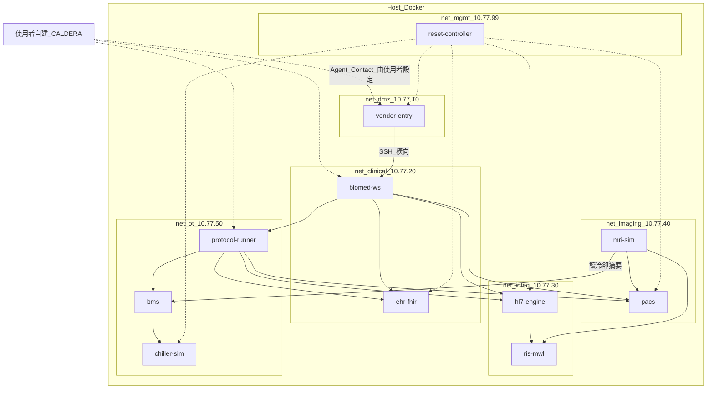
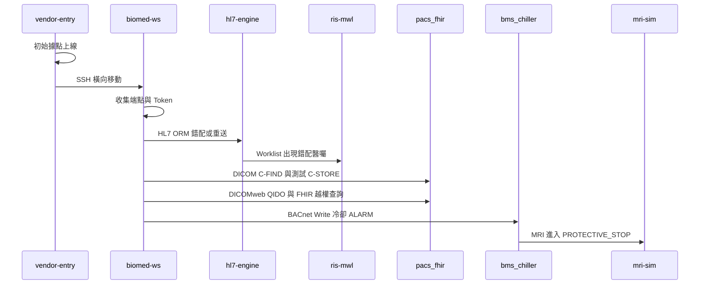

# PRD：迷你虛擬醫院 Docker 靶場環境

| 欄位 | 內容 |
|---|---|
| 文件類型 | Product Requirements Document（環境建置） |
| 版本 | 1.0 |
| 日期 | 2026-07-25 |
| 依據 | [迷你虛擬醫院紅隊靶機設計_v1.0.md](./迷你虛擬醫院紅隊靶機設計_v1.0.md) |
| 部署形態 | **全部 Docker／Docker Compose** |
| 範圍排除 | **CALDERA Server、Plugin、Ability、Adversary、Operation**（由使用者自行建立） |
| 對接文件 | [CALDERA-對接說明.md](./CALDERA-對接說明.md) |

---

## 1. 產品目標

建立一座可重複重置的「迷你虛擬醫院」隔離靶場，滿足：

1. 以 Docker Compose 一鍵啟動完整醫療流程相關服務。
2. 具備可展示的正常 MRI／冷卻聯動流程（攻擊前基線）。
3. 植入可重置的刻意弱點，支援紅隊攻擊鏈演練。
4. 預留 Sandcat／Agent 安裝點與網路連通性，供外部 CALDERA 對接。
5. 提供一鍵 Reset，恢復相同 Seed 狀態。

**不實作：** 藍隊／SIEM、真實病患資料、真實設備控制、CALDERA 本體及 Ability Pack。

> 所有攻擊只能發生在隔離實驗室，並使用合成病患、合成影像與虛擬設備。

---

## 2. 範圍界定

### 2.1 In Scope（本專案交付）

- 多網段 Docker 網路與所有靶場容器
- 醫療協議模擬服務：HL7 v2／MLLP、DICOM MWL、DICOM DIMSE、DICOMweb、FHIR R4、BACnet
- 初始據點與醫療工程工作站容器（含弱密碼、可達性、憑證檔 seed）
- 協議執行容器 `protocol-runner`（預裝協議客戶端工具，供 Agent 或手動呼叫）
- 合成病患／影像／FHIR Bundle Seed
- Reset Controller（重置資料與服務狀態）
- **CALDERA 對接手冊**（端點、帳密、建議 Facts、網路允許清單）

### 2.2 Out of Scope（使用者自行負責）

- CALDERA Server 安裝與設定
- Sandcat Agent 二進位部署與 C2 連線設定（靶場只留安裝路徑與說明）
- Ability／Adversary／Planner／Debrief／Operation Report
- `hospital_protocols` plugin 與 `hospital-runner` 白名單編排邏輯（可選：靶場只提供等效 CLI 腳本供手動驗證）

---

## 3. 使用者故事

| ID | 角色 | 故事 | 驗收 |
|---|---|---|---|
| US-01 | 靶場維運 | 我只要 `docker compose up -d` 就能啟動整座醫院 | 所有服務 healthy |
| US-02 | 演示者 | 攻擊前能跑通病患→醫囑→Worklist→影像→FHIR→冷卻正常 | UI／API 可見基線狀態 |
| US-03 | 紅隊 | 我能從 vendor-entry SSH 到 biomed-ws，並觸達各協議端點 | 連通與憑證檔存在 |
| US-04 | 紅隊 | 我能手動／腳本觸發 HL7 錯配、DICOM 測試寫入、BACnet ALARM→MRI 停機 | 狀態可見變化 |
| US-05 | CALDERA 操作者 | 我拿到對接文件後，能自行把 Agent 裝上並編排攻擊 | 文件含 IP／Port／憑證／建議步驟 |
| US-06 | 演示者 | 一鍵 reset 後狀態與首次啟動相同 | Seed 一致 |

---

## 4. 架構與 Docker 網路



### 4.1 Compose 網路規格

| Network 名稱 | Subnet | 用途 |
|---|---|---|
| `hosp-dmz` | `10.77.10.0/24` | 廠商入口 |
| `hosp-clinical` | `10.77.20.0/24` | 醫療工程站、FHIR |
| `hosp-integ` | `10.77.30.0/24` | HL7、RIS |
| `hosp-imaging` | `10.77.40.0/24` | PACS、MRI |
| `hosp-ot` | `10.77.50.0/24` | BACnet、protocol-runner |
| `hosp-mgmt` | `10.77.99.0/24` | Reset |

**連通規則（Compose 以多 network attach 模擬）：**

- `vendor-entry`：僅 `hosp-dmz` + 可達 `biomed-ws:22`（刻意弱點 V-02）
- `biomed-ws`：掛 `hosp-clinical`，並可達 integ／imaging／ot（V-10）
- `protocol-runner`：掛 ot，並可達 HL7／PACS／FHIR／BMS
- `reset-controller`：掛 mgmt + 各服務管理 API／volume 存取
- **不含** `hosp-caldera` 網段；使用者自建 CALDERA 時，自行把 Agent 出口指到其 C2（建議經 host gateway 或額外 attach 外部網路）

### 4.2 容器清單與固定 IP

| Service | 容器名 | IP | Image 策略 | 對外 Port（Host 映射，便於演示） |
|---|---|---|---|---|
| `vendor-entry` | `hosp-vendor-entry` | 10.77.10.20 | 自建 Dockerfile（debian + sshd） | `2221:22` |
| `biomed-ws` | `hosp-biomed-ws` | 10.77.20.10 | 自建（sshd + 工具 + seed 檔） | `2222:22` |
| `ehr-fhir` | `hosp-ehr-fhir` | 10.77.20.20 | HAPI FHIR R4 官方／自訂設定 | `8080:8080` |
| `hl7-engine` | `hosp-hl7-engine` | 10.77.30.10 | 自建 Python MLLP | `2575:2575` |
| `ris-mwl` | `hosp-ris-mwl` | 10.77.30.20 | 自建／輕量 MWL SCP | `11114:11114` |
| `pacs` | `hosp-pacs` | 10.77.40.10 | Orthanc | `8042:8042`, `11112:11112` |
| `mri-sim` | `hosp-mri-sim` | 10.77.40.20 | 自建狀態 API + DICOM client | `8090:8090` |
| `bms` | `hosp-bms` | 10.77.50.10 | 自建 BACnet 客戶端／簡易 UI API | `8091:8091` |
| `chiller-sim` | `hosp-chiller` | 10.77.50.20 | 自建 bacpypes3 Device | UDP 47808（容器網內） |
| `protocol-runner` | `hosp-protocol-runner` | 10.77.50.40 | 自建（工具齊全、可裝 Agent） | `2223:22`（可選） |
| `reset-controller` | `hosp-reset` | 10.77.99.10 | 自建 API／CLI | `8099:8099` |

**明確不包含：** `caldera-server`、`red-operator` 容器。

---

## 5. 功能需求（服務行為）

### 5.1 正常醫院流程（必須先可跑通）

1. Seed／reset 建立合成病患 `patient-001`
2. HL7 發送／接收 `ADT^A01`、`ORM^O01`
3. RIS 產生 DICOM Modality Worklist
4. MRI 以 C-FIND 取 Worklist，產生合成 DICOM，C-STORE 至 Orthanc
5. Orthanc 提供 DIMSE + DICOMweb；FHIR 寫入／可查 `Patient`、`ImagingStudy`
6. `chiller-sim` 冷卻 = `NORMAL` → MRI 狀態 = `READY`

### 5.2 刻意弱點（設定檔可開關，Reset 恢復）

| ID | 位置 | 行為 |
|---|---|---|
| V-01 | vendor-entry | 測試帳 `vendor`／弱密碼 `Vendor@123`（文件標註，僅實驗室） |
| V-02 | vendor→biomed | vendor 金鑰或同密碼可 SSH 至 biomed-ws |
| V-03 | biomed-ws | `/opt/hospital/creds/` 存放 HL7 endpoint、AE Title、過寬 Token |
| V-04 | hl7-engine | 明文 MLLP；來源 IP 在允許清單即接受 |
| V-05 | hl7-engine | 不拒絕重複 `MSH-10` |
| V-06 | pacs | AE Title 近似身分驗證（寬鬆 Accept） |
| V-07 | pacs／seed | DICOMweb 測試 Token scope 過大 |
| V-08 | ehr-fhir | 無病患資源級授權（Bearer 測試 token 即可廣查） |
| V-09 | chiller／bms | BACnet WriteProperty 不限制來源 |
| V-10 | 網路 | biomed-ws／protocol-runner 可達多協議區 |

### 5.3 攻擊效果可觀測點（供 CALDERA／手動驗證）

| 效果 | 觀測方式 |
|---|---|
| HL7 醫囑錯配 | RIS／MRI Worklist API 或 UI 出現重複／錯 PID |
| DICOM 測試寫入 | Orthanc 出現 `TEST-` 前綴 Study，不覆寫基線 Study |
| FHIR 越權 | 以測試 Token 查到非原 scope 的合成 Patient／ImagingStudy |
| BACnet→MRI | BMS API 顯示 ALARM；MRI API `status=PROTECTIVE_STOP` |

### 5.4 Reset Controller

`POST /reset` 或 `docker compose run reset-controller reset` 必須：

1. 清空／還原 Orthanc、FHIR、HL7／RIS DB 或 volume
2. 重播 Seed（ADT、ORM、基線 C-STORE、FHIR Bundle）
3. BACnet 冷卻恢復 `NORMAL`
4. MRI 恢復 `READY`
5. 回傳 JSON：`{ "ok": true, "seed_version": "..." }`

---

## 6. 攻擊鏈（環境需支援的路徑）

環境本身不執行 CALDERA，但必須讓以下鏈路在 Docker 內可行：

```text
vendor-entry (初始據點)
    → SSH 橫向 → biomed-ws
        → 讀取 /opt/hospital/creds/*
        → 觸達 hl7-engine / pacs / ehr-fhir / bms
            → HL7 錯配 ORM
            → DICOM C-ECHO / C-FIND / 測試 C-STORE
            → DICOMweb QIDO / FHIR Search
            → BACnet Write → MRI PROTECTIVE_STOP
```



`protocol-runner` 預裝：`curl`、`dcmtk`（或同等）、HL7 發送腳本、BACnet 寫入腳本，方便使用者之後把 CALDERA Ability 指到這些命令。

---

## 7. 技術選型（固定）

| 元件 | 技術 |
|---|---|
| 編排 | Docker Compose v2（多 network、固定 ipv4） |
| HL7 | Python + 輕量 MLLP server（建議 hl7apy） |
| RIS／MWL | Python／pynetdicom MWL SCP |
| PACS | Orthanc（DICOM + DICOMweb plugin） |
| FHIR | HAPI FHIR R4 |
| BACnet | bacpypes3 |
| MRI／BMS API | FastAPI 或 Flask |
| 入口主機 | debian/ubuntu + openssh-server |
| Seed 資料 | 倉庫內 `seed/`（合成，無真實 PHI） |

---

## 8. 建議倉庫結構

```text
AIS3_FUZZY/
├── docker-compose.yml
├── .env.example
├── services/
│   ├── hl7-engine/
│   ├── ris-mwl/
│   ├── pacs/                 # orthanc.json
│   ├── ehr-fhir/
│   ├── mri-sim/
│   ├── bms/
│   ├── chiller-sim/
│   ├── protocol-runner/
│   └── reset-controller/
├── hosts/
│   ├── vendor-entry/
│   └── biomed-ws/
├── seed/
│   ├── patients/
│   ├── dicom/
│   └── fhir/
├── scripts/
│   ├── smoke-test.sh         # 正常流程自檢
│   └── attack-manual-demo.sh # 不依賴 CALDERA 的手動攻擊鏈驗證
└── docs/
    ├── PRD-迷你虛擬醫院Docker靶場.md
    └── CALDERA-對接說明.md
```

---

## 9. 詳細建置步驟

### 階段 0：前置條件

1. 安裝 Docker Engine + Compose Plugin
2. 建議資源：≥ 8 CPU、16 GB RAM、50 GB 磁碟（MVP）；完整展示建議 32 GB+
3. 確認本機未佔用 `2221`／`2222`／`2575`／`8042`／`8080`／`8090`／`8091`／`8099`／`11112`
4. Clone 本倉庫，複製 `.env.example` → `.env`

### 階段 1：Compose 骨架與網路

1. 建立 `docker-compose.yml`：六個 bridge network + 固定 subnet／IPAM
2. 先放 healthcheck 佔位服務驗證 IP 可 ping
3. 以 `docker network inspect` 確認結果符合 4.1

### 階段 2：臨床整合鏈（HL7 → RIS → PACS）

1. 實作 `hl7-engine`：監聽 `2575`，解析 ADT／ORM，轉呼叫 RIS API
2. 實作 `ris-mwl`：維護 Worklist；提供 DICOM MWL C-FIND
3. 部署 Orthanc：AE Title `HOSP_PACS`、開啟 DICOMweb、寬鬆 peer
4. 寫入 `seed/` 合成病患與測試 DICOM
5. 以 `scripts/smoke-test.sh` 驗證：送 ORM → Worklist 有單 → C-STORE 成功

### 階段 3：FHIR + MRI + BACnet

1. 啟動 HAPI FHIR；Seed Bundle；設定測試 Bearer Token（過寬）
2. 實作 `chiller-sim`（Device ID `42001`）與 `bms` 讀寫 API
3. 實作 `mri-sim`：輪詢 BMS；`NORMAL→READY`、`ALARM→PROTECTIVE_STOP`
4. MRI 完成基線掃描路徑（C-FIND → 合成圖 → C-STORE → 可選寫 FHIR ImagingStudy）

### 階段 4：入口主機與橫向路徑

1. 建 `vendor-entry`、`biomed-ws` Dockerfile（sshd、弱密碼、authorized_keys）
2. 在 biomed 放置 `/opt/hospital/creds/endpoints.env` 與 token 檔（V-03）
3. 驗證：host `ssh -p 2221` → 容器內再 ssh 到 `10.77.20.10`
4. 建 `protocol-runner`：安裝 dcmtk、hl7／bacnet demo CLI

### 階段 5：Reset 與手動攻擊驗證

1. 實作 `reset-controller`（API + compose profile）
2. 實作 `attack-manual-demo.sh`：依序 HL7 錯配 → 測試 C-STORE → BACnet ALARM
3. 驗證觀測點（5.3）後執行 reset，再次 smoke-test 通過

### 階段 6：CALDERA 對接文件（非實作 CALDERA）

產出 [CALDERA-對接說明.md](./CALDERA-對接說明.md)，至少包含：

- 建議 Agent 安裝目標：`vendor-entry`、`biomed-ws`、（可選）`protocol-runner`
- 容器內如何取得 shell／持久化 Agent
- 建議 C2 連線方式（`host.docker.internal`／額外 external network）
- 建議 Facts 清單
- 建議 Ability 呼叫的本地命令對照
- 安全聲明：僅隔離實驗室、僅合成資料

---

## 10. 日常操作指令（Runbook 摘要）

```bash
# 啟動靶場（不含 CALDERA）
docker compose up -d --build

# 健康檢查／正常流程
./scripts/smoke-test.sh

# 手動攻擊鏈驗證（不依賴 CALDERA）
./scripts/attack-manual-demo.sh

# 一鍵重置
curl -X POST http://127.0.0.1:8099/reset
# 或
docker compose run --rm reset-controller reset

# 停止
docker compose down
# 連 volume 清掉（破壞性）
docker compose down -v
```

---

## 11. 驗收條件（環境側）

| ID | 項目 | 通過條件 |
|---|---|---|
| ENV-01 | Compose 啟動 | `docker compose ps` 全部 healthy／running |
| ENV-02 | 網路 IP | 各服務固定 IP 符合 4.2 |
| ENV-03 | 正常流程 | smoke-test 通過（HL7→MWL→PACS→FHIR→MRI READY） |
| ENV-04 | 橫向 | vendor SSH → biomed 成功 |
| ENV-05 | 憑證 seed | biomed `/opt/hospital/creds/` 存在且可用 |
| ENV-06 | HL7 錯配 | 手動重送後 Worklist 可見異常 |
| ENV-07 | DICOM 測試 | Orthanc 出現 TEST Study |
| ENV-08 | BACnet 影響 | Write 後 MRI = `PROTECTIVE_STOP` |
| ENV-09 | Reset | reset 後 smoke-test 再次通過 |
| ENV-10 | 對接文件 | `CALDERA-對接說明.md` 含端點／憑證／Agent 建議 |
| ENV-11 | 無 CALDERA 依賴 | 倉庫 compose **不**啟動 caldera 服務即可完成 ENV-01～09 |

---

## 12. 非功能需求

- 所有示範資料必須為合成資料，文件標明禁止連真實醫院網路
- 映像建置可離線重現（鎖定 tag／digest 於 compose）
- 單一 `docker compose up` 啟動時間目標 < 5 分鐘（冷啟動含 build 可放寬）
- 日誌輸出足夠演示（HL7 收包、C-STORE、BACnet write、MRI 狀態轉換）

---

## 13. 與原設計文件的差異

| 原設計 | 本 PRD |
|---|---|
| 含 caldera-server 容器 | **排除**；使用者自建 |
| hospital_protocols／hospital-runner 為 CALDERA Ability | 改為環境側 CLI＋對接文件；Ability 由使用者實作 |
| VM + Container 混合 | **全部 Docker Compose** |
| 完整 6 場景獨立 Operation | 環境支援完整攻擊鏈；CALDERA 場景編排不在範圍 |

---

## 14. MVP 交付範圍

優先交付 **MVP Docker 靶場**：

- `vendor-entry`、`biomed-ws`
- `hl7-engine`、`ris-mwl`、`pacs`、`ehr-fhir`
- `mri-sim`、`bms`、`chiller-sim`
- `protocol-runner`、`reset-controller`
- `smoke-test.sh`／`attack-manual-demo.sh`
- [CALDERA-對接說明.md](./CALDERA-對接說明.md)

暫緩：獨立 `viewer` 容器（改用 Orthanc Web UI）。
