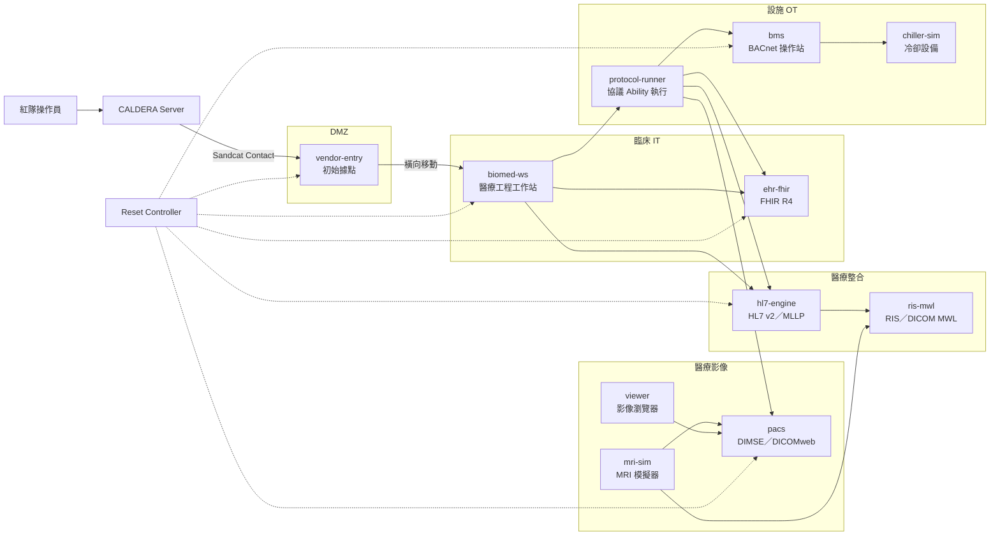
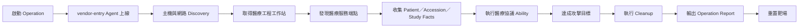
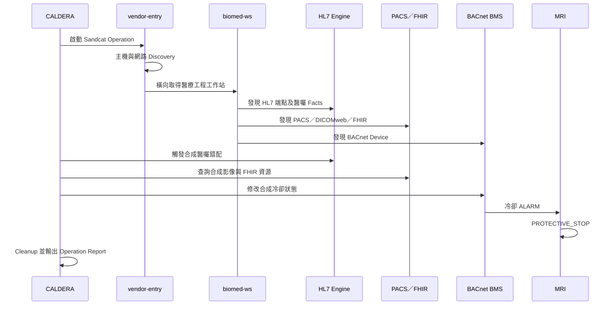

# 迷你虛擬醫院紅隊靶機與 CALDERA 攻擊設計

## 1. 專題定位

本專題只實作紅隊攻擊模擬，目標是：

1. 建立一座具有醫療流程的虛擬醫院靶機。
2. 使用 CALDERA 編排攻擊行為。
3. 從預設初始據點進入醫院內網。
4. 發現並移動至醫療資訊、醫療影像及設施 OT 區域。
5. 對 BACnet、HL7、DICOM、DICOMweb 及 FHIR 執行安全的協議效果模擬。
6. 在操作完成後輸出 CALDERA Operation Report。
7. 一鍵恢復靶場初始狀態，方便重複展示。

本專題不實作：

- 藍隊 SOC。
- SIEM 偵測規則。
- 事件應變流程。
- 醫院正式資安防護。
- 真實醫療設備控制。
- 真實病患資料。

> 所有攻擊只能發生在隔離實驗室，並使用合成病患、合成影像與虛擬設備。

---

## 2. CALDERA 在專題中的角色

CALDERA 主要是對手模擬與後滲透編排平台，不應把它當成單純的弱點掃描器。

本專題採用以下模型：

```text
預設初始據點
    ↓
CALDERA Sandcat Agent 上線
    ↓
CALDERA 執行 Discovery／Credential／Lateral Movement
    ↓
取得醫療工程或維護工作站
    ↓
執行 BACnet／HL7／DICOM／FHIR Abilities
    ↓
完成攻擊目標並輸出 Operation Report
```

為避免專題耗費大量時間在 Initial Access Exploit，本設計在 `vendor-entry` 預先安裝 Sandcat Agent，代表攻擊者已透過弱密碼、釣魚或廠商帳號取得第一個據點。

如果需要在展示中呈現「進入醫院」：

1. 展示廠商入口存在弱密碼。
2. 以測試帳號登入。
3. 啟用原本暫停的 Sandcat Agent。
4. 從 CALDERA 啟動 Operation。

這樣能清楚表達初始入侵，但不需要開發額外的真實漏洞利用程式。

---

## 3. 靶場拓撲



---

## 4. 網路規劃

| 區域 | 網段 | 用途 |
|---|---|---|
| DMZ | `10.77.10.0/24` | 廠商維護入口與初始據點 |
| 臨床 IT | `10.77.20.0/24` | 醫療工程工作站、EHR、FHIR |
| 醫療整合 | `10.77.30.0/24` | HL7 Engine、RIS、MWL |
| 醫療影像 | `10.77.40.0/24` | MRI、PACS、DICOMweb |
| 設施 OT | `10.77.50.0/24` | BMS、BACnet、冷卻機 |
| CALDERA | `10.77.70.0/24` | CALDERA Server、紅隊操作台 |
| 管理／重置 | `10.77.99.0/24` | 快照、重置、情境 Seed |

CALDERA 網段只能與 Agent Contact 及紅隊操作台通訊，不可直接繞過攻擊路徑連入所有靶機。

---

## 5. 靶機清單

| 主機 | IP | 形式 | 角色 | 是否安裝 Agent |
|---|---:|---|---|---|
| `caldera-server` | `10.77.70.10` | Linux VM／Container | CALDERA Core、Plugin、Operation | 不適用 |
| `red-operator` | `10.77.70.20` | 桌面 VM | 紅隊操作介面 | 否 |
| `vendor-entry` | `10.77.10.20` | Linux VM | 預設初始據點 | Sandcat |
| `biomed-ws` | `10.77.20.10` | Linux／Windows VM | 醫療工程工作站及橫向目標 | Sandcat |
| `ehr-fhir` | `10.77.20.20` | Container | EHR-lite、FHIR R4 | 否 |
| `hl7-engine` | `10.77.30.10` | Container | HL7 v2／MLLP | 否 |
| `ris-mwl` | `10.77.30.20` | Container | RIS、DICOM MWL SCP | 否 |
| `pacs` | `10.77.40.10` | Container | DICOM DIMSE、DICOMweb | 否 |
| `mri-sim` | `10.77.40.20` | Container | MRI 狀態及影像生成 | 否 |
| `viewer` | `10.77.40.30` | Container | DICOMweb Viewer | 否 |
| `bms` | `10.77.50.10` | Container | BACnet 操作站 | 否 |
| `chiller-sim` | `10.77.50.20` | Container | BACnet 冷卻設備 | 否 |
| `protocol-runner` | `10.77.50.40` | Hardened Container | 醫療協議 Ability 執行 | 受限 Sandcat |
| `reset-controller` | `10.77.99.10` | Container | 重置、Seed、快照 | 否 |

### 5.1 建議資源

本專題可使用：

- 12–16 CPU 核心。
- 32–64 GB RAM。
- 300–500 GB SSD。
- 一台虛擬化主機或具多個 VM／Container 的實驗環境。

---

## 6. 正常醫院流程

攻擊前必須先跑通正常流程，否則無法展示攻擊造成的差異。

### 6.1 正常 MRI 流程

1. EHR 建立合成病患。
2. EHR 發送 HL7 `ADT^A01`。
3. 醫師建立 MRI 醫囑並發送 `ORM^O01`。
4. RIS 建立 DICOM Modality Worklist。
5. MRI 使用 C-FIND 查詢 Worklist。
6. MRI 送出 MPPS N-CREATE。
7. MRI 產生合成 DICOM Study。
8. MRI 使用 C-STORE 將影像送至 PACS。
9. Viewer 使用 DICOMweb 查詢及瀏覽影像。
10. 報告以 `ORU^R01` 及 FHIR `DiagnosticReport` 回到 EHR。

### 6.2 正常 BACnet 流程

1. `chiller-sim` 提供供水溫度、回水溫度、泵浦及警報 Object。
2. BMS 使用 ReadProperty 讀取資料。
3. MRI 狀態引擎取得冷卻摘要。
4. 冷卻狀態正常時，MRI 為 `READY`。
5. 合成冷卻狀態異常時，MRI 進入 `PROTECTIVE_STOP`。

---

## 7. 靶機弱點

本專題只需要可展示、可重置的弱點，不需要使用真實產品 CVE。

| ID | 靶機 | 弱點 |
|---|---|---|
| `V-01` | `vendor-entry` | 共用測試帳號或弱密碼 |
| `V-02` | `vendor-entry` → `biomed-ws` | 維護區到醫療工程工作站的權限過大 |
| `V-03` | `biomed-ws` | 保存測試環境端點、AE Title 或 API Token |
| `V-04` | `hl7-engine` | 明文 MLLP，只依來源 IP 信任 |
| `V-05` | `hl7-engine` | 未檢查重複 `MSH-10` |
| `V-06` | `pacs` | AE Title 被當成身分驗證 |
| `V-07` | `pacs` | DICOMweb Token Scope 過大 |
| `V-08` | `ehr-fhir` | FHIR 缺少病患資源級授權 |
| `V-09` | `bms` | BACnet WriteProperty 來源未限制 |
| `V-10` | 網路 | 醫療工程工作站可到達多個醫療協議區 |

弱點透過設定檔開啟，重置時恢復初始配置。

---

## 8. CALDERA 架構

### 8.1 使用元件

| 元件 | 用途 |
|---|---|
| CALDERA Core | Operation、Ability、Adversary、Fact、Agent 管理 |
| Sandcat | `vendor-entry`、`biomed-ws` 及受限 `protocol-runner` Agent |
| Stockpile | 通用主機發現、帳號、檔案及橫向行為 |
| Caldera for OT／BACnet | BACnet 探索及協議操作 |
| `hospital_protocols` | 自建 HL7、DICOM、DICOMweb、FHIR Ability Pack |
| Debrief | 產生 Operation 結果與展示報告 |

### 8.2 Agent Group

```text
hospital-entry      → vendor-entry
hospital-biomed     → biomed-ws
hospital-protocol   → protocol-runner
```

`protocol-runner` 不提供任意 Shell，只能執行白名單化醫療協議 Ability。

### 8.3 Facts

```yaml
hospital.hl7.endpoint: 10.77.30.10:2575
hospital.ris.endpoint: 10.77.30.20:11114
hospital.pacs.endpoint: 10.77.40.10:11112
hospital.dicomweb.endpoint: https://10.77.40.10/dicom-web
hospital.fhir.endpoint: https://10.77.20.20/fhir
hospital.bacnet.device_id: 42001
hospital.patient.id: patient-001
hospital.accession: accession-001
hospital.study_uid: synthetic-study-uid
```

### 8.4 Ability 分類

| Ability Prefix | 類型 | 執行位置 |
|---|---|---|
| `HOSP-HOST-*` | 主機發現、檔案、憑證、網路 | `vendor-entry`／`biomed-ws` |
| `HOSP-BAC-*` | BACnet 探索及合成屬性操作 | `protocol-runner` |
| `HOSP-HL7-*` | HL7 查詢、重送、醫囑錯配效果 | `protocol-runner` |
| `HOSP-DCM-*` | DICOM C-ECHO、C-FIND、測試 C-STORE | `protocol-runner` |
| `HOSP-WEB-*` | DICOMweb QIDO／WADO／STOW 測試 | `protocol-runner` |
| `HOSP-FHIR-*` | FHIR Search、資源存取及一致性效果 | `protocol-runner` |
| `HOSP-CLEAN-*` | Cleanup、Rollback | 對應 Agent |

### 8.5 醫療協議 Ability 包裝

CALDERA Ability 不直接保存任意協議攻擊指令，而是呼叫 `hospital-runner`：

```yaml
id: 11111111-2222-3333-4444-555555555555
name: HOSP-HL7-Order-Mismatch
tactic: impact
platforms:
  linux:
    sh:
      command: >-
        hospital-runner execute
        --ability HOSP-HL7-01
        --scenario CAP-01
        --target #{hospital.hl7.endpoint}
        --patient #{hospital.patient.id}
      cleanup: >-
        hospital-runner rollback
        --ability HOSP-HL7-01
        --scenario CAP-01
```

`hospital-runner` 必須驗證：

1. Ability 是否在白名單。
2. 目標是否在 `10.77.0.0/16`。
3. Patient、Accession 及 Study UID 是否屬於合成資料。
4. 事件數量及速率是否在限制內。
5. 是否存在相對應 Cleanup Ability。

---

## 9. CALDERA 攻擊流程



### 9.1 Operation 設定

```yaml
operation:
  name: HOSPITAL-REDTEAM-DEMO-01
  agent_group: hospital-entry
  adversary_profile: HOSP-CAP-01
  planner: atomic
  source: hospital-seed
  auto_close: true
```

第一版建議使用固定順序的 Adversary Profile，不使用動態 Planner，確保每次專題展示結果一致。

---

## 10. 攻擊場景

### 10.1 RT-01：從廠商入口移動至醫療工程工作站

#### 目標

從 `vendor-entry` 取得醫院內部醫療工程工作站的執行權限。

#### CALDERA 階段

1. Sandcat Agent 在 `vendor-entry` 上線。
2. 執行主機、使用者、網路及路由 Discovery。
3. 發現醫療工程工作站。
4. 取得測試維護憑證或可用連線方式。
5. `biomed-ws` Agent 進入 Operation。

#### 成功條件

- CALDERA 顯示兩台 Agent。
- Operation Facts 包含醫療工程工作站。
- 能從 `biomed-ws` 到達醫療協議端點。

### 10.2 RT-02：HL7 醫囑錯配

#### 目標

修改或重送合成 MRI 醫囑，使 RIS Worklist 出現重複或錯誤病患。

#### 攻擊流程

1. 從 `biomed-ws` 找到 HL7 Engine 端點。
2. 收集測試 Patient ID 及 Order ID。
3. 將端點資料寫入 CALDERA Facts。
4. 透過 `protocol-runner` 執行 `HOSP-HL7-01`。
5. RIS Worklist 出現預期的測試異常。

#### 成功條件

- CALDERA Ability 回傳成功。
- `MSH-10`、`PID-3` 或 `ORC-2` 的預期差異可被展示。
- MRI Worklist UI 顯示重複或錯配的合成醫囑。

### 10.3 RT-03：DICOM DIMSE 查詢與測試影像儲存

#### 目標

發現 PACS、查詢合成 Study，並存入帶有明確測試標記的合成 DICOM 影像。

#### 攻擊流程

1. 收集 PACS IP、連接埠及 AE Title。
2. 執行 C-ECHO。
3. 執行受限 C-FIND。
4. 將預先製作的合成測試 Study 以 C-STORE 傳送至 PACS。
5. 從 Viewer 查詢測試 Study。

#### 成功條件

- CALDERA 取得 PACS 與 Study UID Facts。
- PACS 顯示測試 Study。
- 測試 Study 不覆寫正常影像。

### 10.4 RT-04：DICOMweb 越權查詢

#### 目標

使用權限過大的測試 Token 查詢超出原病患範圍的合成 Study。

#### 攻擊流程

1. 從醫療工程工作站取得測試 Token。
2. 執行 QIDO-RS 查詢。
3. 使用 WADO-RS 取得測試影像或縮圖。
4. 將 Study UID、結果數及下載量寫入 CALDERA Results。

#### 成功條件

- 能查到至少一個非原病患範圍的合成 Study。
- Operation Report 顯示 Token Scope 及 Study UID。

### 10.5 RT-05：FHIR 資源越權

#### 目標

使用測試應用 Token 查詢非授權合成 Patient、ImagingStudy 或 DiagnosticReport。

#### 攻擊流程

1. 收集 FHIR Base URL。
2. 取得測試 Token。
3. 查詢 CapabilityStatement。
4. 查詢合成 Patient 或 ImagingStudy。
5. 比對 FHIR Study UID 與 PACS Study UID。

#### 成功條件

- CALDERA Result 包含 Resource Type、Resource ID 及 Study UID。
- 能證明測試 Token 的資源範圍過大。

### 10.6 RT-06：BACnet 冷卻狀態影響 MRI

#### 目標

使用 CALDERA for OT／BACnet Ability 修改合成冷卻狀態，使 MRI 模擬器進入保護停機。

#### 攻擊流程

1. 從 `protocol-runner` 發現 BACnet Device。
2. 收集合成 Device Instance、Object ID 及 Property。
3. 執行白名單 WriteProperty Ability。
4. 將冷卻狀態由 `NORMAL` 改為 `ALARM`。
5. MRI 轉換為 `PROTECTIVE_STOP`。

#### 成功條件

- CALDERA Result 顯示 Device、Object、舊值及新值。
- MRI UI 顯示保護停機。
- MRI 不接受新檢查，但既有合成影像仍保留。

### 10.7 RT-CAP：完整專題展示



---

## 11. 專題展示流程

建議展示時間約 10–15 分鐘。

### 第一部分：正常醫院

1. 顯示合成病患入院。
2. 顯示 MRI Worklist。
3. 顯示 MRI 完成掃描。
4. 顯示 PACS／DICOMweb 影像。
5. 顯示 FHIR ImagingStudy。
6. 顯示 BMS 冷卻狀態正常。

### 第二部分：CALDERA 攻擊

1. 開啟 CALDERA Operation。
2. 顯示 `vendor-entry` Agent。
3. 執行 Discovery。
4. 顯示 `biomed-ws` Agent 加入。
5. 收集醫療服務 Facts。
6. 執行 HL7、DICOMweb／FHIR 或 BACnet Ability。
7. 顯示醫院靶機的狀態變化。

### 第三部分：結果

1. 顯示 CALDERA Operation Graph。
2. 顯示執行成功的 Abilities。
3. 顯示收集到的 Facts。
4. 顯示醫療流程遭影響的 UI。
5. 執行 Cleanup。
6. 輸出 Operation Report。
7. 一鍵重置靶場。

---

## 12. 重置流程

1. 關閉 CALDERA Operation。
2. 停止或移除 Sandcat Agent。
3. 清除未執行 Links、暫存 Payload 及本輪 Facts。
4. 恢復 `vendor-entry` 與 `biomed-ws` 快照。
5. 恢復 EHR、HL7、PACS、FHIR、BMS 資料庫。
6. 使用固定 Seed 重新建立合成病患。
7. 重播 ADT、ORM、MWL、MPPS 及 C-STORE。
8. 將 BACnet 冷卻狀態恢復為 `NORMAL`。
9. 確認 MRI 回到 `READY`。

---

## 13. 驗收條件

| ID | 驗收項目 | 通過條件 |
|---|---|---|
| `AT-01` | CALDERA Server | UI、API、Plugin 正常 |
| `AT-02` | 初始 Agent | `vendor-entry` Sandcat 可加入 Operation |
| `AT-03` | 橫向流程 | `biomed-ws` 可成為第二 Agent |
| `AT-04` | Facts | 能取得 HL7、PACS、FHIR、BACnet 端點 |
| `AT-05` | HL7 Ability | 能產生合成 Worklist 錯配 |
| `AT-06` | DICOM Ability | 能查詢及儲存合成測試 Study |
| `AT-07` | DICOMweb Ability | 能執行受限 QIDO／WADO |
| `AT-08` | FHIR Ability | 能展示資源越權或一致性異常 |
| `AT-09` | BACnet Ability | 能讓 MRI 進入 `PROTECTIVE_STOP` |
| `AT-10` | Cleanup | 所有 Ability 具有回復方式 |
| `AT-11` | Operation Report | 能輸出完整執行結果與 Facts |
| `AT-12` | Reset | 能恢復相同初始病患及設備狀態 |

---

## 14. 建議實施順序

| 階段 | 工作 |
|---|---|
| 第 1 階段 | 建立 CALDERA、Sandcat、網路與兩台 Agent 主機 |
| 第 2 階段 | 建立 EHR、HL7、RIS、MRI、PACS 正常流程 |
| 第 3 階段 | 建立 FHIR、DICOMweb 與 BACnet 模擬 |
| 第 4 階段 | 製作通用主機 Discovery／Lateral Abilities |
| 第 5 階段 | 製作 `hospital_protocols` 及 `hospital-runner` |
| 第 6 階段 | 建立六個獨立攻擊場景 |
| 第 7 階段 | 建立 RT-CAP 完整展示 Operation |
| 第 8 階段 | 完成 Cleanup、Report 與一鍵重置 |

若專題時間不足，最小可行版本建議只完成：

1. CALDERA 初始 Agent 及橫向移動。
2. HL7 醫囑錯配。
3. DICOM／DICOMweb 查詢。
4. BACnet 冷卻狀態影響 MRI。
5. Operation Report 與重置。

---