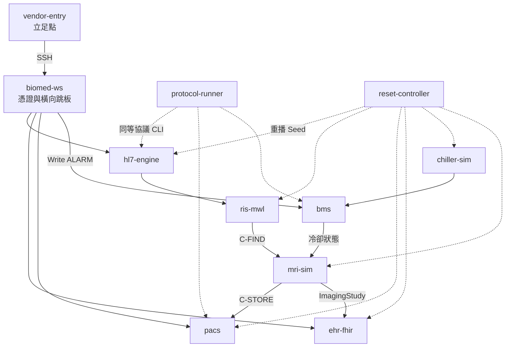

# 迷你虛擬醫院靶場：各容器職責與串接情境

| 欄位 | 內容 |
|---|---|
| 版本 | 1.0 |
| 日期 | 2026-07-25 |
| 相關 | [靶場架構圖.md](./靶場架構圖.md)、[PRD](./PRD-迷你虛擬醫院Docker靶場.md) |

> 用「一家迷你醫院怎麼運轉、攻擊者怎麼穿過去」的方式說明每個容器。

---

## 1. 一句話總覽

這座靶場模擬的是：

1. **廠商入口**被當初始據點；
2. 橫向進到 **醫療工程工作站**；
3. 從那裡碰 **醫囑（HL7）→ 檢查排程（RIS）→ 掃影像（MRI）→ 存檔（PACS）→ 病歷（FHIR）**；
4. 同時可動 **冷卻（BACnet）**，讓 MRI 進入保護停機；
5. 演示完用 **Reset** 回到同一套合成 Seed。

---

## 2. 每個容器在做什麼

### 入口與工作站

| 容器 | 主要在做什麼 |
|---|---|
| **vendor-entry** | 醫院「廠商遠端入口」。給紅隊一個合法 SSH 立足點（弱密碼帳號）。本身幾乎不跑醫療協議，重點是**進得去、再跳下一台**。 |
| **biomed-ws** | 醫療工程／維護工作站。裡頭放了端點清單與過寬 Token（`/opt/hospital/creds/`），是橫向後的**指揮據點**：從這裡連 HL7、PACS、FHIR、BMS。 |
| **protocol-runner** | 協議工具箱主機。預裝 `hl7-send`、`dicom-test-store`、`bacnet-write` 等 CLI，方便手動演示或之後讓 CALDERA Ability 直接呼叫，不必在 biomed 上臨時裝套件。 |

### 臨床整合與病歷

| 容器 | 主要在做什麼 |
|---|---|
| **hl7-engine** | 醫院訊息交換中心（HL7 v2／MLLP）。收 `ADT`（病患入院／建檔）與 `ORM`（醫囑），轉呼叫 RIS。刻意接受明文、不擋重複訊息，方便演練錯配／重送。 |
| **ris-mwl** | 放射資訊系統的精簡版：維護 **Modality Worklist**（誰、何時、做哪種 MRI），並用 DICOM C-FIND 給 MRI 查排程；也提供 HTTP API 方便觀測。 |
| **ehr-fhir** | 電子病歷的 FHIR R4 端（HAPI）。存放合成 `Patient`、`ImagingStudy` 等；測試 Token 權限過寬，可示範越權查詢。 |

### 影像與設備

| 容器 | 主要在做什麼 |
|---|---|
| **pacs** | 影像歸檔（Orthanc）。收 DICOM C-STORE，提供 Web／DICOMweb 查閱。AE Title 驗證寬鬆；基線 Study 與攻擊用 `TEST-` Study 都會出現在這裡。 |
| **mri-sim** | MRI 掃描器模擬器。平時輪詢 BMS 冷卻狀態：`NORMAL→READY`、`ALARM→PROTECTIVE_STOP`。就緒時可依 Worklist 取單、產生合成影像、存進 PACS，並可寫 FHIR。 |
| **bms** | 設施監控站（Building Management）。對外給「冷卻摘要」API，並當 BACnet Write 的閘道，把寫入轉給 chiller。MRI、攻擊腳本都看它。 |
| **chiller-sim** | MRI 冷卻設備模擬。狀態只有 `NORMAL`／`ALARM`；可被 BMS 或 UDP WriteProperty 改寫（不限制來源）。一變 ALARM，MRI 就該停。 |

### 維運

| 容器 | 主要在做什麼 |
|---|---|
| **reset-controller** | 一鍵復原。清空各服務狀態、重播 `seed/`（HL7、FHIR）、把冷卻拉回 NORMAL、觸發基線掃描，回傳 `seed_version`。 |

---

## 3. 它們怎麼串在一起

可以把整座醫院想成兩條主線：**看病流程** 與 **機房聯鎖**，再加一條 **攻擊者路徑**。

```text
【看病主線】
  HL7 建檔／下醫囑 → RIS 排進 Worklist → MRI 取單掃描 → PACS 存圖 → FHIR 留紀錄

【機房聯鎖】
  chiller 冷卻狀態 → BMS 摘要 → MRI 決定能不能掃（READY / PROTECTIVE_STOP）

【攻擊者路徑】
  vendor-entry → biomed-ws（拿憑證）→ 亂 HL7／寫測試 DICOM／查 FHIR／寫 BACnet
```

---

## 4. 情境 A：正常一天（攻擊前基線）

**目的：** 證明醫院「本來是通的」，之後攻擊造成的異常才有對照。

1. **reset-controller**（或首次 smoke-test）播種合成病患 `patient-001`。
2. **hl7-engine** 收到 `ADT^A01`（建檔）與 `ORM^O01`（開 MRI 醫囑）。
3. **ris-mwl** 出現一筆 Worklist：`ACC-001`、病患 `patient-001`、模態 `MR`。
4. **chiller-sim** 為 `NORMAL`，**bms** 回報正常，**mri-sim** 顯示 `READY`。
5. **mri-sim** 對 RIS 做 C-FIND，拿到排程後產生合成 DICOM，C-STORE 到 **pacs**。
6. 可選寫入 **ehr-fhir** 的 `ImagingStudy`；演示者可在 Orthanc UI（8042）與 FHIR（8080）看到基線結果。

**你應看到：** Worklist 有單、PACS 有圖、MRI = READY、FHIR 有 `Patient/patient-001`。

---

## 5. 情境 B：紅隊走完攻擊鏈（手動或之後接 CALDERA）

**目的：** 從初始據點一路做到「醫囑錯亂＋測試影像＋冷卻警報讓 MRI 停機」。

1. **進門**  
   SSH 進 **vendor-entry**（弱密碼）。此容器代表廠商維護入口，已在 DMZ。

2. **橫向**  
   從 vendor 再 SSH 到 **biomed-ws**（同密碼或共用金鑰）。這是醫療工程站，跨網段可達 integ／imaging／ot。

3. **蒐集**  
   讀 `/opt/hospital/creds/endpoints.env` 與 token 檔，取得 HL7、PACS、FHIR、BMS 位址與過寬憑證。

4. **搞亂醫囑**  
   對 **hl7-engine** 重送／錯配 `ORM`（例如同一 `ACC-001` 卻綁 `patient-002`）。  
   **ris-mwl** Worklist 出現重複或錯 PID → 演示「錯配檢查對象」。

5. **測影像寫入**  
   對 **pacs** 做 C-ECHO，再 C-STORE 一筆 `TEST-` 前綴 Study。  
   Orthanc 多出測試影像，且不應覆寫基線 `ACC-001` 那筆。

6. **越權查病歷**  
   用過寬 Bearer Token 查 **ehr-fhir**，看到不該（在真實環境）一次廣查到的多個合成 Patient。

7. **打冷卻、逼 MRI 停**  
   經 **bms**（或 protocol-runner 的 `bacnet-write`）對 **chiller-sim** 寫入 `ALARM`。  
   **mri-sim** 輪詢到警報後變 `PROTECTIVE_STOP` → 掃描被聯鎖停住。

**你應看到：** Worklist 異常、Orthanc 有 `TEST-` Study、BMS=ALARM、MRI=PROTECTIVE_STOP。

（等價路徑：全程在 **protocol-runner** 跑 CLI，效果相同，適合當 Ability 執行點。）

---

## 6. 情境 C：演示結束一鍵重來

1. 呼叫 `POST http://127.0.0.1:8099/reset`（**reset-controller**）。
2. 清空 HL7／RIS／PACS／FHIR 狀態，冷卻回 `NORMAL`。
3. 重播 Seed，再跑一次基線掃描。
4. 回到與情境 A 相同的可重現狀態（同一 `seed_version`）。

---

## 7. 用一張關係圖記串接



---

## 8. 對照：誰跟誰說話（協議）

| 從 | 到 | 怎麼連 | 典型內容 |
|---|---|---|---|
| 任何人／腳本 | hl7-engine | MLLP :2575 | ADT、ORM |
| hl7-engine | ris-mwl | HTTP | 建病患／加 Worklist |
| mri-sim | ris-mwl | DICOM C-FIND :11114 | 取排程 |
| mri-sim | pacs | DICOM C-STORE :11112 | 存合成影像 |
| mri-sim | bms | HTTP | 讀冷卻 |
| bms | chiller-sim | HTTP（＋實驗室 BACnet UDP） | 讀寫 NORMAL／ALARM |
| biomed／runner | ehr-fhir | FHIR REST :8080 | Patient／ImagingStudy |
| vendor-entry | biomed-ws | SSH :22 | 橫向移動 |
| 演示者 | reset-controller | HTTP :8099 | 全場重置 |

更細的 IP／Port／帳密見 [靶場架構圖.md](./靶場架構圖.md) 與 [CALDERA-對接說明.md](./CALDERA-對接說明.md)。
