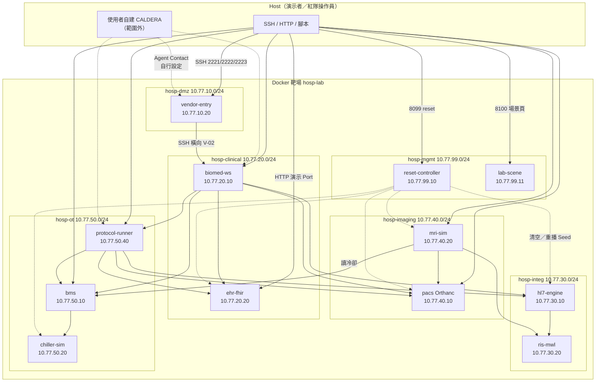
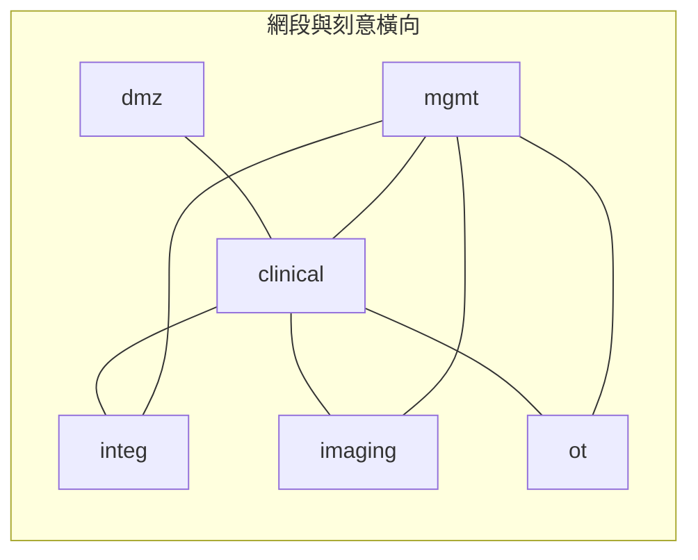
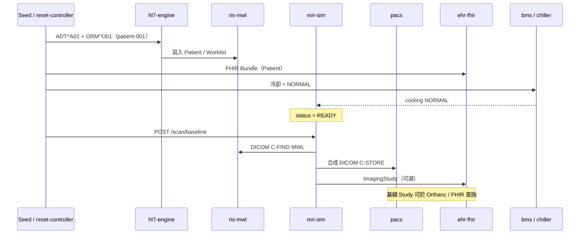
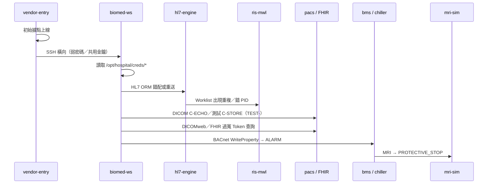
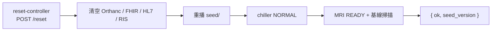
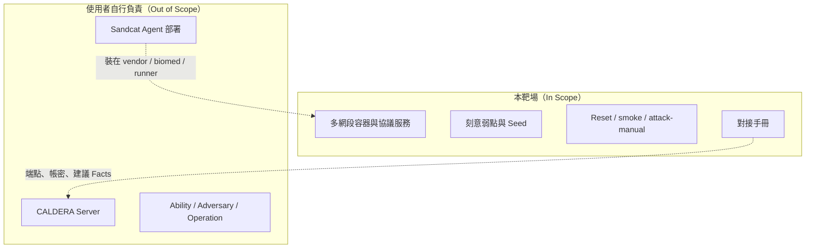

# 迷你虛擬醫院 Docker 靶場架構圖

| 欄位 | 內容 |
|---|---|
| 版本 | 1.0 |
| 日期 | 2026-07-25 |
| 部署 | `lab/`（Docker Compose） |
| 依據 | [PRD-迷你虛擬醫院Docker靶場.md](./PRD-迷你虛擬醫院Docker靶場.md) |
| 對接 | [CALDERA-對接說明.md](./CALDERA-對接說明.md) |

> 僅限隔離實驗室。合成資料；不含 CALDERA Server。

---

## 1. 總覽

靶場以 **六個 Docker bridge 網段** 模擬醫院分區，共 **12 個容器**：入口主機、臨床整合、影像、OT 設施、協議執行、Reset，以及觀測用場景狀態頁。



---

## 2. 網路分區

| Network | Subnet | 用途 |
|---|---|---|
| `hosp-dmz` | `10.77.10.0/24` | 廠商入口（初始據點） |
| `hosp-clinical` | `10.77.20.0/24` | 醫療工程站、FHIR |
| `hosp-integ` | `10.77.30.0/24` | HL7、RIS／MWL |
| `hosp-imaging` | `10.77.40.0/24` | PACS、MRI |
| `hosp-ot` | `10.77.50.0/24` | BACnet／BMS、protocol-runner |
| `hosp-mgmt` | `10.77.99.0/24` | Reset 管理 |

**連通模擬（多 network attach）：**

- `vendor-entry`：`dmz` + `clinical` → 可 SSH 至 `biomed-ws`（V-02）
- `biomed-ws`：`clinical` + `integ` + `imaging` + `ot`（V-10）
- `protocol-runner`：`ot` + `integ` + `imaging` + `clinical`
- `reset-controller`：`mgmt` + 各業務網段（管理 API）
- `lab-scene`：`mgmt` + `dmz` + 各業務網段（觀測聚合，非攻擊面）
- **不含** `hosp-caldera`；CALDERA 由使用者外掛



---

## 3. 容器與對外 Port

| 服務 | 容器名 | 主要 IP | Host 映射 | 角色 |
|---|---|---|---|---|
| vendor-entry | hosp-vendor-entry | 10.77.10.20 | 2221→22 | 初始據點 SSH |
| biomed-ws | hosp-biomed-ws | 10.77.20.10 | 2222→22 | 醫療工程站＋憑證 seed |
| ehr-fhir | hosp-ehr-fhir | 10.77.20.20 | 8080 | HAPI FHIR R4 |
| hl7-engine | hosp-hl7-engine | 10.77.30.10 | 2575 / 8075 | MLLP＋管理 API |
| ris-mwl | hosp-ris-mwl | 10.77.30.20 | 11114 / 8085 | Worklist SCP＋HTTP |
| pacs | hosp-pacs | 10.77.40.10 | 8042 / 11112 | Orthanc DIMSE＋DICOMweb |
| mri-sim | hosp-mri-sim | 10.77.40.20 | 8090 | MRI 狀態／掃描 |
| bms | hosp-bms | 10.77.50.10 | 8091 | 冷卻摘要／BACnet 閘道 |
| chiller-sim | hosp-chiller | 10.77.50.20 | 8092 | 冷卻設備（UDP 47808 網內） |
| protocol-runner | hosp-protocol-runner | 10.77.50.40 | 2223→22 | 協議 CLI／可裝 Agent |
| reset-controller | hosp-reset | 10.77.99.10 | 8099 | 一鍵 Reset |
| lab-scene | hosp-lab-scene | 10.77.99.11 | 8100 | 等角場景狀態頁（觀測） |

---

## 4. 正常臨床流程（基線）

攻擊演示前必須可跑通的「正常醫院流程」：



**狀態基線：** `chiller = NORMAL` → `MRI = READY`，Worklist 含 `patient-001` / `ACC-001`。

---

## 5. 攻擊鏈（環境支援路徑）

環境不執行 CALDERA，但路徑必須在 Docker 內可行：



```text
vendor-entry
  → SSH → biomed-ws
      → /opt/hospital/creds/*
      → hl7-engine / pacs / ehr-fhir / bms
          → HL7 錯配
          → DICOM 測試寫入
          → FHIR 越權查詢
          → BACnet Write → MRI 停機
```

`protocol-runner` 預裝同等 CLI（`hl7-send`、`dicom-test-store`、`bacnet-write`），供手動驗證或之後綁定 CALDERA Ability。

---

## 6. 刻意弱點與觀測點

| ID | 位置 | 行為 |
|---|---|---|
| V-01 | vendor-entry | `vendor` / `Vendor@123` |
| V-02 | vendor→biomed | 同密碼或共用金鑰可 SSH |
| V-03 | biomed-ws | `/opt/hospital/creds/` 端點與過寬 Token |
| V-04 | hl7-engine | 明文 MLLP，來源不嚴格限制 |
| V-05 | hl7-engine | 不拒絕重複 `MSH-10` |
| V-06 | pacs | AE Title 寬鬆 Accept |
| V-07 | pacs／seed | DICOMweb 測試 Token scope 過大 |
| V-08 | ehr-fhir | Bearer 測試 Token 即可廣查 |
| V-09 | chiller／bms | WriteProperty 不限制來源 |
| V-10 | 網路 | biomed／protocol-runner 跨多協議區 |

| 攻擊效果 | 觀測方式 |
|---|---|
| HL7 錯配 | RIS `8085/worklist` 重複／錯 PID |
| DICOM 測試寫入 | Orthanc 出現 `TEST-` Study |
| FHIR 越權 | 測試 Token 查到多個合成 Patient |
| BACnet→MRI | BMS `ALARM`；MRI `PROTECTIVE_STOP` |
| 全院狀態總覽 | `lab-scene` 場景頁 `http://127.0.0.1:8100`（等角俯視＋快捷連結） |

---

## 7. Reset 與倉庫結構



```text
lab/
├── docker-compose.yml
├── .env.example
├── hosts/           # vendor-entry, biomed-ws
├── services/        # hl7, ris, pacs, mri, bms, chiller, protocol-runner, reset, lab-scene
├── seed/            # patients, fhir, dicom
├── scripts/         # smoke-test.sh, attack-manual-demo.sh
└── keys/            # 實驗室共用 SSH 金鑰
```

---

## 8. 與 CALDERA 的邊界



詳細端點與建議 Facts 見 [CALDERA-對接說明.md](./CALDERA-對接說明.md)。

各容器職責與串接故事見 [靶場服務與串接情境.md](./靶場服務與串接情境.md)。
